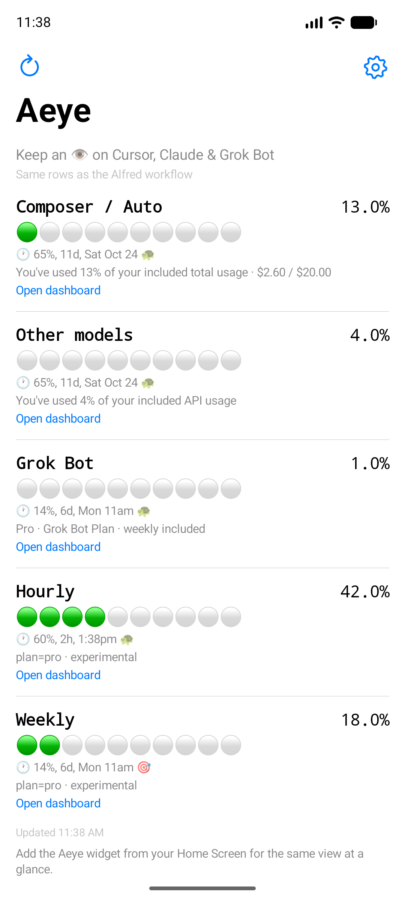
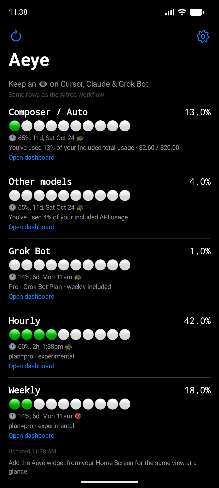
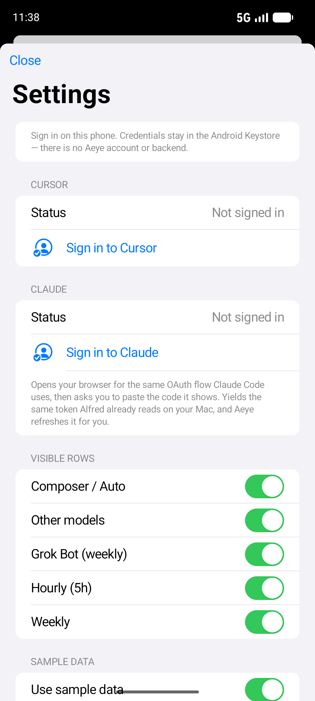
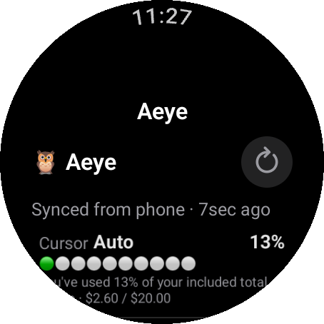
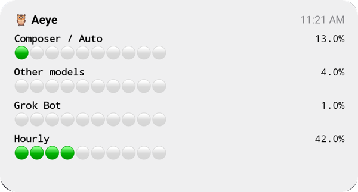
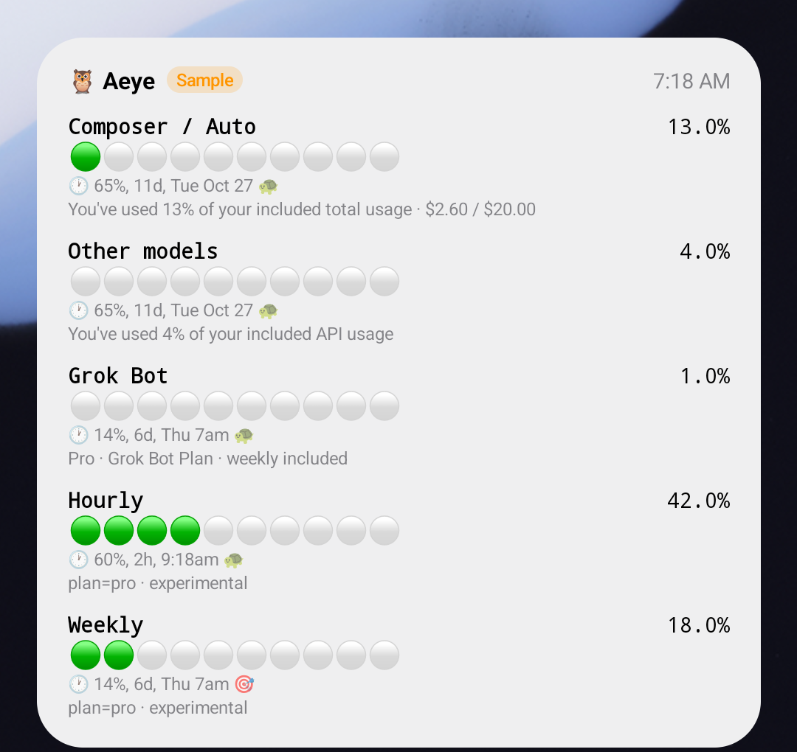

# Aeye for Android — phone, widget & Wear OS

Native Android port of the [iOS app](../ios/README.md), kept as close as possible to iOS 1.0.1:
the same five rows as the [Alfred workflow](../README.md), the same wording, data rules, sign-in
flows and sample mode, and deliberately the same iOS look (large title, inset-grouped Settings
sheet that stacks over the overview, iOS switches, the shaded circle meter). Plan and parity
checklist: [`docs/port-plan.md`](docs/port-plan.md). Publishing: [`PLAY_STORE.md`](PLAY_STORE.md).

| Row | Source |
|-----|--------|
| Composer / Auto | Cursor spending page (`autoPercentUsed`) |
| Other models | Cursor (`apiPercentUsed`) |
| Grok Bot | Cursor weekly included Bot allowance (`get-sand-usage-status`) |
| Hourly | Claude 5-hour session limit |
| Weekly | Claude weekly limit |

## Surfaces

| iOS | Android |
|-----|---------|
| iPhone app | Phone app — overview + Settings sheet (sign-in, row toggles, sample data) |
| iPhone widget (Medium / Large) | Home Screen widget, 4×2 by default, resizable to 4×4 for the Large layout |
| Apple Watch app | Wear OS app — same list, refresh button, auto-pull when the cache is over two minutes old |
| Watch complications | Complication data source: short text (circular), ranged value (corner / gauge), long text (rectangular / inline) |
| Smart Stack widget | Wear OS tile |

The watch holds no Cursor or Claude credentials. The phone publishes every snapshot to the
Wearable Data Layer; the watch caches it for offline glances, complications and the tile, and can
ask the phone for a fresh one (the request starts the phone app in the background and the reply
carries the snapshot). Out of range, the request is left as a data item and delivered on the next
connection.

## Modules

| Module | What |
|---|---|
| `:core` | Pure Kotlin, no Android. Port of `ios/Shared`: models and the snapshot JSON (reads what the iOS encoder writes), `AeyeFormatting`, `ClaudeClient` + `ClaudeOAuth`, `CursorClient` + `CursorAuth`, `CredentialsStore`, `AeyeService` (60 s cache, request coalescing), `MockSnapshot`, the Wear protocol and the meter palette. 49 JUnit tests in `core/src/test`. |
| `:app` | Phone. `ui/ios/` is the iOS look kit (palette, type scale, forms, navigation bar with collapsing large title, page sheets, switches, context menu, SF-Symbol-like icons); `ui/` has one file per iOS view. `widget/` is the Glance widget, `wear/` the Data Layer sender and refresh listener, `Platform.kt` the Keystore secret store and snapshot store. |
| `:wear` | Wear OS app (`studio.cimento.aeye` as well — the Data Layer only connects apps with the same package name and signing key), complication data source, tile. |

## Build & test

```bash
export JAVA_HOME="/Applications/Android Studio.app/Contents/jbr/Contents/Home"
./gradlew :core:test                               # 49 JVM tests
./gradlew :app:assembleDebug :wear:assembleDebug   # debug APKs
./gradlew :app:bundleRelease :wear:bundleRelease   # AABs, signed if keystore.properties exists
```

Toolchain: Gradle 9.8 · AGP 9.4 (built-in Kotlin) · Kotlin 2.4.20 · compileSdk 37 · targetSdk 36
· minSdk 26 (phone) / 30 (Wear OS). SDK at `/usr/local/share/android-commandlinetools`.
Emulators used for development: `aeye_pixel` (Pixel 8a profile) and `aeye_wear` (Wear OS large
round).

Launcher icons are generated from the iOS icon: `python3 scripts/make_icons.py`.

### Screenshots and sample data

Debug builds accept the iOS screenshot launch arguments as intent extras. They force the sample on
without writing the preference, and without the "Sample data" chip:

```bash
adb shell am start -n studio.cimento.aeye/com.giovanni.aeye.MainActivity --ez screenshot true
adb shell am start -n studio.cimento.aeye/com.giovanni.aeye.MainActivity --ez screenshot_settings true
adb shell am start -n studio.cimento.aeye/com.giovanni.aeye.wear.WatchActivity --ez screenshot true
# watch only: store the labelled sample as if the phone had sent it, for complications and the tile
adb shell am start -n studio.cimento.aeye/com.giovanni.aeye.wear.WatchActivity --ez seed true
```

Force-stop the app between captures. **Settings → Sample data → Use sample data** is the
user-facing switch, as on iOS; signing in turns it off.

| | |
|---|---|
|  |  |
|  |  |

|  |  |
|---|---|

## Sign-in

Same flows as iOS, with a Chrome Custom Tab in place of `ASWebAuthenticationSession` — it shares
the browser's cookies, and Google and other SSO providers work there (they refuse to run inside an
app's web view).

- **Claude**: Claude Code's OAuth client (`claude.com/cai/oauth/authorize` → `platform.claude.com`
  token exchange, PKCE). The client only registers the copy-the-code redirect, so the last step is
  a paste. Access and refresh tokens are stored, and refreshed two minutes before expiry and once
  more on a 401/403.
- **Cursor**: the `cursor login` browser flow (`cursor.com/loginDeepControl`, polling
  `api2.cursor.sh/auth/poll`). Nothing to paste; when the poll returns, Aeye closes the tab and
  comes back to the front.
- **Advanced** still accepts a pasted token. Pasted Claude tokens have no refresh token.

## Where things differ from iOS, and why

| iOS | Android |
|---|---|
| Keychain, `AfterFirstUnlockThisDeviceOnly` | AES-GCM key in the Android Keystore; ciphertext in its own prefs file, excluded from backup and device transfer |
| App Group container | App storage — the Glance widget runs in the app's process |
| `ASWebAuthenticationSession` | Chrome Custom Tab |
| WatchConnectivity | Wearable Data Layer: data item (application context), `MessageClient.sendRequest` (message with reply), data item (`transferUserInfo`) |
| Apple Color Emoji meter | Drawn shaded discs sampled from the iPhone's emoji, so the meter looks the same; other emoji (🕐 🐢 🔥 🎯 🦉) use the system emoji font |
| SF Symbols | Drawn `arrow.clockwise`, `gearshape`, `person.crop.circle.badge.checkmark`, `safari`, `doc.on.doc` |
| Sheet swipe-down | System back, or drag the sheet's bar down |
| Widget timeline every 15 min | The app updates the widget on every refresh; the system adds one every 30 min (its minimum) |
| watchOS relative date, text that shrinks to fit | Compact age ("5sec", "2min 5sec"); the status line wraps to two lines instead |

Copy changes only where iOS names an Apple thing: "Keychain" → "Android Keystore", "Safari" →
"your browser", "iPhone" → "phone", "Watch" → "watch".

## Not yet verified / not done

- **Phone ↔ watch sync on paired devices.** The Data Layer code paths (publish, live request with
  reply, queued request) build, and the watch's out-of-reach path was exercised on an emulator,
  but pairing a phone and a Wear emulator needs the Wear OS companion app and a Google account, so
  the round trip has not been run. Check it on real hardware before release.
- Not on Play yet. The privacy page the About section links to
  (`https://giovannicoppola.github.io/alfred-aeye/android/privacy.html`) is live, published from
  [`docs/privacy.html`](docs/privacy.html). Upload key, signed bundles, listing and screenshots
  are ready; the Play Console steps are in [`PLAY_STORE.md`](PLAY_STORE.md).
